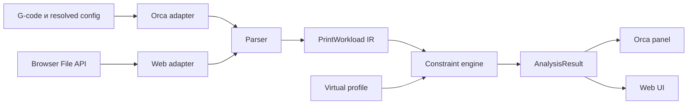

# Архитектура Bottleneck3D

Статус: проектирование, 22 августа 2026 года.

## Архитектурная цель

Bottleneck3D должен иметь одно поведение и один формат результата в трёх
сценариях:

1. самостоятельное локальное веб-приложение;
2. нативный плагин OrcaSlicer;
3. ограниченный post-processing adapter для старых версий OrcaSlicer.

Анализ не должен зависеть от React, OrcaSlicer, файловой системы или сети.
Интеграции отвечают только за получение входных данных, отображение результата
и хранение пользовательских настроек.

## Проверенные возможности OrcaSlicer

В версиях новее 2.4.2 и nightly-сборках OrcaSlicer доступна нативная Python
Plugin System:

- локальная установка `.py` или `.whl`;
- `SlicingPipelineCapabilityBase` и шаг `psGCodePostProcess`;
- чтение resolved-настроек через `ctx.config_value(key)`;
- локальный путь G-code через `ctx.gcode_path`;
- `ScriptPluginCapabilityBase` для запуска из окна Plugins;
- встроенные HTML-диалоги и постоянные окна через `orca.host.ui`;
- двусторонняя передача JSON между Python и HTML-окном.

Ограничение: slicing-pipeline capability работает в worker thread.
Документация прямо запрещает вызывать `orca.host.ui.*` из этого hook, поскольку
GUI может ждать завершения slicing и получить deadlock.

Официальные источники:

- [Plugin system](https://github.com/OrcaSlicer/OrcaSlicer/wiki/plugin_system)
- [Slicing pipeline](https://github.com/OrcaSlicer/OrcaSlicer/wiki/slicing)
- [Host UI](https://github.com/OrcaSlicer/OrcaSlicer/wiki/host_ui)
- [Getting started](https://github.com/OrcaSlicer/OrcaSlicer/wiki/plugins_getting_started)
- [Post-processing scripts](https://github.com/OrcaSlicer/OrcaSlicer/wiki/others_settings_post_processing_scripts)
- [Acceleration settings](https://github.com/OrcaSlicer/OrcaSlicer/wiki/speed_settings_acceleration)
- [Material volumetric speed limitation](https://github.com/OrcaSlicer/OrcaSlicer/wiki/material_volumetric_speed_limitation)

## Источники данных о принтере

Ручной ввод не является основным источником данных. Пользователь часто не
помнит реальные настройки, а иногда даже не знает, что конкретный G-code уже
переопределяет acceleration, jerk или flow. Поэтому каждый числовой параметр в
`PrinterProfile` хранится не как голое число, а как наблюдение:

```text
ProfileField<T> = {
  value: T,
  source: ProfileSource,
  confidence: high | medium | low | unknown,
  key?: string,
  observedAt?: string,
  notes?: string[]
}
```

### Иерархия источников

| Приоритет | Источник | Что даёт | Доверие |
| --- | --- | --- | --- |
| 1 | Текущий G-code | Фактические `G1 F`, экструзию, `M201`, `M203`, `M204`, `M205`, `M220`, `M221`, fan-команды, паузы | Высокое для команд, которые реально присутствуют |
| 2 | Orca `ctx.config_value` | Resolved-настройки выбранных printer/process/filament профилей | Высокое для того, чем слайсер пользовался при расчёте |
| 3 | Метаданные G-code | Комментарии слайсера, estimated time, профили, роли линий | Среднее: зависят от включённых комментариев и версии |
| 4 | Локальная история Bottleneck3D | Предыдущие подтверждённые калибровки пользователя | Среднее или высокое после явного подтверждения |
| 5 | Ручной ввод | Override и fallback для веб-версии без Orca | Низкое, пока пользователь не подтвердил источник |

Если источники конфликтуют, пользователь видит это явно. Например:

> В профиле Orca travel acceleration = 12000 мм/с², но G-code содержит
> `M204 T8000`. Для этой оценки использую 8000, потому что это команда,
> которая попадёт в печать.

### Данные из Orca profile extractor

`ProfileExtractor` должен читать resolved-настройки через `ctx.config_value`.
Минимальный набор:

- firmware и формат G-code:
  - `gcode_flavor`;
  - `emit_machine_limits_to_gcode`;
- машинные лимиты:
  - `machine_max_acceleration_x`;
  - `machine_max_acceleration_y`;
  - `machine_max_acceleration_z`;
  - `machine_max_acceleration_e`;
  - `machine_max_speed_x`;
  - `machine_max_speed_y`;
  - `machine_max_speed_z`;
  - `machine_max_speed_e`;
  - `machine_max_acceleration_extruding`;
  - `machine_max_acceleration_retracting`;
  - `machine_max_acceleration_travel`;
  - `machine_max_jerk_x`;
  - `machine_max_jerk_y`;
  - `machine_max_jerk_z`;
  - `machine_max_jerk_e`;
  - `machine_max_junction_deviation`;
- process acceleration:
  - `default_acceleration`;
  - `outer_wall_acceleration`;
  - `inner_wall_acceleration`;
  - `sparse_infill_acceleration`;
  - `internal_solid_infill_acceleration`;
  - `top_surface_acceleration`;
  - `bridge_acceleration`;
  - `initial_layer_acceleration`;
  - `initial_layer_travel_acceleration`;
  - `travel_acceleration`;
  - `accel_to_decel_enable`;
  - `accel_to_decel_factor`;
- хотэнд и филамент:
  - `filament_diameter`;
  - `filament_max_volumetric_speed`;
  - `filament_adaptive_volumetric_speed`;
  - `volumetric_speed_coefficients`;
  - `nozzle_diameter`;
  - `nozzle_volume`;
  - `nozzle_hrc`;
  - `required_nozzle_HRC`;
- охлаждение и замедление слоя:
  - `slow_down_layer_time`;
  - `slow_down_min_speed`;
  - `fan_min_speed`;
  - `fan_max_speed`;
  - `full_fan_speed_layer`;
  - `disable_fan_first_layers`;

`filament_max_volumetric_speed` трактуется как `slicer_filament_limit`, а не как
доказанная физическая производительность хотэнда. Это хороший автоматический
старт, но для рекомендации покупки нужен источник выше по качеству: локальная
калибровка, эталонная печать или явное подтверждение пользователя.

### Данные из G-code parser

G-code parser строит не только траекторию, но и временную шкалу активных
настроек:

- `G0`/`G1`: фактическая подача и геометрия сегментов;
- `G2`/`G3`: дуги, пока как warning до реализации;
- `G90`/`G91`, `M82`/`M83`, `G92`: режимы координат и экструдера;
- `M201`: machine acceleration limits;
- `M203`: machine speed limits;
- `M204`: active print/travel acceleration;
- `M205`: jerk / junction deviation, если прошивка использует эти команды;
- `M106`/`M107`: фактические команды обдува;
- `M220`: глобальный speed factor;
- `M221`: flow factor;
- `M600`, `M0`, `M1`, `G4`: паузы и события, влияющие на время.

G-code-команды имеют приоритет над настройками профиля только с момента, где они
встретились. Например, `M204` в середине файла меняет ускорение для последующих
сегментов, а не для уже разобранной траектории.

### Правила неопределённости

- Значение `0` в acceleration-полях Orca часто означает «использовать firmware
  default», а не реальный ноль. Такое поле получает `confidence: unknown`, если
  нет `M204`/`M201` в G-code или явного machine limit.
- Если `emit_machine_limits_to_gcode` выключен, но plugin API доступен, берём
  machine limits из resolved Orca profile и показываем источник.
- Если есть только веб-импорт G-code без Orca и без machine-limit команд,
  приложение просит выбрать пресет или ввести недостающие лимиты, а результат
  помечает как `low confidence`.
- Если филаментный flow ниже ожидаемой мощности хотэнда, диагноз формулируется
  как «ограничение выбранного профиля/материала», а не «хотэнд физически слабый».
- Рекомендации железа запрещены, пока критичные поля имеют `unknown` или
  конфликт источников не разрешён.

### UX источников данных

В интерфейсе рядом с каждым ключевым числом должна быть карточка источника:

- `Из Orca profile`;
- `Из G-code M204`;
- `Из филамент-профиля`;
- `Введено вручную`;
- `Неизвестно`.

Кнопка ручного изменения называется не «настройка принтера», а «override для
симуляции», чтобы пользователь понимал: он меняет сценарий расчёта, а не
подтверждает факт.

## Что именно считает Bottleneck3D

Нельзя смешивать три разных слоя:

1. **Возможности принтера** — физические и firmware-лимиты: хотэнд, моторы,
   кинематика, обдув, охлаждение, input shaping, firmware defaults.
2. **Намерение слайсера** — выбранные пользователем или профилем цели:
   скорости, ускорения, line width, layer height, volumetric limits, minimum
   layer time, role-based параметры.
3. **Сгенерированный G-code** — уже готовая траектория с подачами, паузами и
   командами, которую получит принтер.

Итоговый G-code часто уже оптимизирован и ограничен под текущий профиль. Если
Orca снизила `G1 F` из-за `filament_max_volumetric_speed`, один только G-code
уже не хранит исходное желание печатать быстрее. Поэтому анализ финального файла
не имеет права заявлять:

> Этот хотэнд физически слабый.

Он может заявлять только:

> В этом уже сгенерированном плане печати скорость ограничена текущим flow-limit
> профиля/материала.

### Режимы ответа

| Режим | Входные данные | На что отвечает | Что запрещено обещать |
| --- | --- | --- | --- |
| `emitted_gcode_audit` | Только готовый G-code | Почему этот файл печатается столько и какие команды/лимиты в нём видны | Выигрыш от переслайса с новым железом |
| `orca_profile_analysis` | G-code + resolved profile Orca | Какие лимиты выбранного профиля сформировали этот G-code | Физическую мощность железа без калибровки |
| `reslice_simulation` | Workload + slicer intent + alternate profile | Что будет, если пересчитать скорости под другой профиль/апгрейд | Точность выше проверенной на fixtures |
| `hardware_capability` | Калибровки, firmware/profile, фактические печати | На что способен принтер как машина | Рекомендации без свежих источников |

Первый публичный сценарий Orca должен целиться не в «угадывание железа», а в:

> Этот print/profile сейчас упирается в такой-то лимит. Если изменить именно
> этот лимит и пересчитать план, ожидаемый выигрыш такой-то.

### Параметры железа за пределами текущего audit

В audit готового G-code не нужно знать массу головы или напряжение моторов:
файл уже содержит скорости и команды, которые принтер получит. Но для режима
`hardware_capability` и честных рекомендаций апгрейдов этих данных уже
недостаточно. Нужен отдельный `HardwareCapabilityProfile`.

| Группа | Примеры параметров | Зачем нужны | Источник |
| --- | --- | --- | --- |
| Движущаяся масса | масса головы, масса балки/gantry, масса bed на bedslinger, центр масс | Оценить безопасный прирост acceleration и ringing risk | измерение, BOM, CAD, локальный профиль |
| Жёсткость и ремни | тип/длина ремней, ширина ремня, натяжение, pulley teeth, backlash, рама/балка | Понять, даст ли лёгкая балка или натяжка эффект | ручной ввод, калибровка, input-shaper тест |
| Моторы и драйверы | модель моторов, ток `run_current`, `hold_current`, driver type, microsteps, interpolation | Оценить torque margin и риск layer shift | Klipper/Marlin config, ручной ввод |
| Электрика | напряжение питания 12/24/48 В, лимит PSU, board current limits, cooling драйверов | Понять, упрётся ли скорость в back-EMF/питание/нагрев | firmware config, hardware profile |
| Firmware motion | `max_velocity`, `max_accel`, `square_corner_velocity`, jerk/JD, accel_to_decel, input shaper | Отличить профиль слайсера от реального лимита прошивки | G-code, Moonraker/Klipper, Marlin config |
| Экструдер | передатка, motor current, max extruder accel, grip, pressure advance, retract limits | Отличить хотэнд-flow от проблем подачи | firmware config, калибровка |
| Хотэнд | мощность нагревателя, melt zone, nozzle type, CHT/обычное сопло, теплопроводность блока | Оценить реальный max volumetric flow | калибровка flow, профиль компонента |
| Охлаждение | модель вентиляторов, duct, PWM range, airflow, материал, chamber temp | Понять, правда ли мелкие слои упираются в обдув | профиль, тест мостов/overhang, ручной ввод |
| Материал | тип, бренд/партия, температура, влажность, MVS по материалу | Не смешивать лимит PLA/PETG/ABS и физику хотэнда | filament profile, калибровка |

Эти параметры не должны подмешиваться в `emitted_gcode_audit` как скрытые
догадки. Если их нет, Bottleneck3D может сказать:

> G-code/profile ограничен acceleration.

Но не должен говорить:

> Вам нужна более лёгкая балка.

Для такого вывода нужна минимум одна из проверок:

- Klipper/Moonraker read-only snapshot с firmware лимитами и stepper config;
- ручной hardware profile с источниками и confidence;
- input shaper / ringing test;
- фактическая печать или калибровка acceleration;
- known-good component profile для конкретного принтера.

### Как использовать физические параметры

Физика железа нужна не для пересчёта уже готового файла, а для проверки
допустимости виртуального апгрейда:

```text
reslice_simulation proposes higher acceleration
hardware_capability checks whether machine can safely sustain it
recommendation engine decides whether a part upgrade is justified
```

Пример:

1. `reslice_simulation` показывает, что acceleration 15000 вместо 7000 экономит
   18 минут.
2. `hardware_capability` видит тяжёлую голову, низкий motor current и input
   shaper с сильным ringing.
3. Рекомендация становится не «поставьте CHT», а «сначала проверьте механический
   лимит: лёгкая голова/балка или снижение массы могут дать эффект».

### Последствия для виртуального тюнинга

Ползунок апгрейда не должен просто ускорять уже capped G-code. Нужны две разные
операции:

1. `auditCurrentPlan` — воспроизвести готовый G-code как есть и показать, что
   реально попадёт в печать.
2. `simulateReslice` — взять `PrintWorkload` плюс slicer intent и заново
   рассчитать достижимые подачи под виртуальный профиль.

Если intent недоступен, UI обязан понизить режим:

> Можно проверить только текущий G-code. Для честного прогноза апгрейда откройте
> модель через Orca-плагин или дайте профиль слайсера.

### Что нужно сохранить для `simulateReslice`

`PrintWorkload` должен хранить не только финальные `G1 F`, но и данные, которые
позволяют восстановить ограничение:

- роль линии: outer wall, inner wall, infill, travel, bridge, support;
- геометрия сегмента и объём экструзии;
- layer height и extrusion width;
- requested role speed из resolved process profile;
- role acceleration из resolved process profile;
- global and filament max volumetric speed;
- minimum layer time и cooling slowdown policy;
- machine motion ability;
- факт, была ли подача уже ограничена слайсером.

Если Orca API на выбранном hook не раскрывает исходную role speed или роль
сегмента, это фиксируется как gap integration spike. Тогда прогноз апгрейда
остаётся `low confidence`, даже если audit готового G-code точный.

### Правило формулировок

Диагноз всегда указывает слой:

- «G-code ограничен командой `M204`»;
- «Профиль Orca ограничивает flow через `filament_max_volumetric_speed`»;
- «По локальной калибровке хотэнд не держит больше 18 мм³/с»;
- «Нельзя оценить апгрейд: в файле нет исходного intent слайсера».

Слова «принтер не может», «хотэнд слабый» или «нужно купить» разрешены только в
режиме `hardware_capability`, когда есть калибровка или фактическая печать.

## Целевой пользовательский сценарий в OrcaSlicer

1. Пользователь устанавливает `bottleneck3d-orca.whl` через
   `File → Plugins → Install local plugin`.
2. Активирует Bottleneck3D и добавляет его как Post-processing Plugin в профиль
   процесса.
3. После slicing/export плагин получает итоговый G-code и resolved-настройки
   принтера, процесса и филамента.
4. Анализ выполняется локально в worker thread и не изменяет G-code.
5. Панель Bottleneck3D показывает диагноз, уверенность расчёта и ограничения.
6. Пользователь меняет виртуальные характеристики хотэнда, обдува или механики.
7. Панель мгновенно пересчитывает результат по уже построенной модели печати.

Желаемый UX — постоянная немодальная панель. Если API конкретной версии Orca
не позволяет надёжно держать её открытой, минимальный fallback — команда
`Open Bottleneck3D` в окне Plugins и модальный отчёт после запроса пользователя.

## Компоненты



### 1. Analysis contracts

Версионированные структуры, не зависящие от языка:

- `PrinterProfile` — физические и firmware-лимиты принтера;
- `HardwareCapabilityProfile` — масса, моторы, питание, жёсткость и калибровки;
- `SlicerContext` — извлечённые resolved-настройки Orca;
- `SlicerIntent` — цели профиля до финального ограничения G-code;
- `PrintWorkload` — компактное представление траектории;
- `VirtualUpgrade` — изменение одного или нескольких лимитов;
- `AnalysisResult` — время, ограничения, уверенность и предупреждения;
- `CompatibilityReport` — неподдерживаемые команды и потерянные данные.

Контракты описываются JSON Schema. Любое изменение формата получает версию.

### 2. Parser

Parser читает G-code потоком и строит `PrintWorkload`. Он не рассчитывает
конкретный апгрейд и не формирует пользовательский текст.

`PrintWorkload` должен сохранять достаточно данных для повторной симуляции:

- длину, подачу и тип каждого значимого сегмента;
- объём экструзии на сегмент;
- слой и роль линии, если она известна;
- режимы координат и экструдера;
- события нагрева, ожидания, ретракта, паузы и смены инструмента;
- неподдерживаемые команды;
- исходную оценку OrcaSlicer и метаданные профилей.

Для экономии памяти однородные сегменты могут агрегироваться в диапазоны или
компактные числовые массивы. Исходная модель пользователя не сохраняется.

### 3. Constraint engine

Чистая детерминированная функция:

```text
evaluate(PrintWorkload, PrinterProfile, VirtualUpgrade) -> AnalysisResult
```

Два этапа — parsing и evaluation — обязательны. Благодаря этому движение
ползунка не перечитывает многомегабайтный G-code.

Движок не решает, какое железо купить. Он сообщает:

- физически активное ограничение;
- добавленное ограничением время;
- чувствительность результата к изменению параметра;
- доверительный интервал;
- причины снижения уверенности.

### 4. Recommendation engine

Отдельный слой получает `AnalysisResult` и локальный каталог компонентов.
Он не имеет права рекомендовать товар, если:

- точность ниже установленного порога;
- апгрейд не даёт минимально значимого выигрыша;
- G-code содержит критичные неподдерживаемые конструкции;
- профиль принтера неполон;
- совместимость компонента с принтером не подтверждена.

Реферальный URL не должен влиять на ранжирование рекомендации.

### 5. Web adapter

- читает файл через Browser File API;
- запускает parser в Web Worker;
- хранит профиль в IndexedDB;
- не содержит сетевых вызовов в контуре анализа;
- отображает тот же `AnalysisResult`, что и Orca-плагин.

### 6. Orca adapter

Плагин состоит из пяти изолированных частей:

- `ProfileExtractor` — переводит `ctx.config_value(...)` в `PrinterProfile`;
- `SlicingCapability` — читает G-code на `psGCodePostProcess` и запускает анализ;
- `ResultStore` — потокобезопасно хранит последний результат и workload;
- `PanelCapability` — создаёт локальное HTML-окно;
- `UiBridge` — передаёт только JSON-команды и результаты.

`SlicingCapability` никогда не вызывает UI. HTML-панель периодически запрашивает
новую ревизию у `ResultStore`; Python отвечает через UI-мост уже вне slicing
hook. Результаты дедуплицируются по хэшу G-code и fingerprint resolved-профиля,
поскольку Orca может отдельно вызывать post-processing при экспорте и отправке.

Плагин анализирует G-code только для чтения. Любое изменение файла считается
отдельной будущей функцией и по умолчанию запрещено.

## Язык вычислительного ядра

Текущий прототип написан на TypeScript. Нативный Orca-плагин работает на Python.
До стабилизации математической модели преждевременно вводить бинарное ядро.

План принятия решения:

1. зафиксировать JSON-контракты и набор эталонных G-code fixtures;
2. вынести текущий TypeScript-анализатор из UI;
3. сделать небольшой Python compatibility spike внутри Orca;
4. прогнать оба движка на одних golden fixtures;
5. измерить скорость и расхождение;
6. если двойная реализация начинает расходиться или Python не укладывается в
   бюджет времени, перенести чистое ядро в Rust:
   - WASM для веб-приложения;
   - Python wheel через PyO3 для OrcaSlicer.

Граница adapters/contracts позволяет сделать этот перенос без переписывания UI.

## Совместимость OrcaSlicer

| Режим | Версия | Возможности |
| --- | --- | --- |
| Native plugin | новее 2.4.2 | Профиль Orca, автоматический анализ, встроенная панель |
| Legacy script | старые версии | Анализ экспортированного G-code, ограниченный отчёт |
| Web import | любая | Ручной выбор G-code, полный интерактивный интерфейс |

Точная минимальная версия будет зафиксирована после теста на официальной stable
сборке. До этого формулировка «новее 2.4.2» повторяет официальную документацию,
а не обещает поддержку конкретного patch-релиза.

## Приватность и безопасность

- G-code, геометрия и профили не покидают устройство.
- UI-пакет плагина не загружает шрифты, скрипты или стили из интернета.
- Каталог апгрейдов отделён от анализа и может поставляться локальным snapshot.
- Сетевое обновление каталога — только по явному согласию.
- Телеметрия по умолчанию отсутствует.
- В отчёте для публикации нет имени файла, геометрии или полного профиля.

## Наблюдаемость без утечки данных

Локальный диагностический лог содержит только:

- версии Orca, плагина, контракта и движка;
- число разобранных команд и типы неподдерживаемых команд;
- длительность этапов parsing/evaluation;
- код результата и stack trace ошибки.

Содержимое G-code, пути, имена файлов и координаты в лог не записываются.

## Открытые решения

1. Минимальная поддерживаемая версия OrcaSlicer.
2. Должна ли панель открываться автоматически после slicing или только по
   кнопке пользователя.
3. Нужен ли legacy post-processing script в первой публичной версии.
4. Разрешено ли локально сохранять последние отчёты.
5. Порог выигрыша, после которого показывается рекомендация.
6. Требуемый бюджет анализа для G-code размером 50, 200 и 500 МБ.
