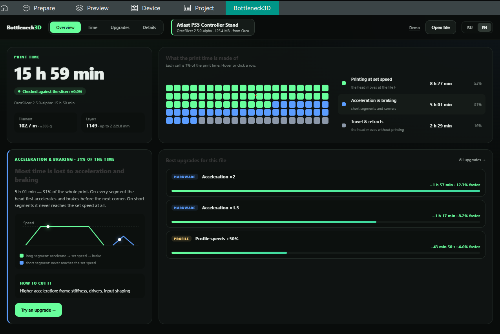
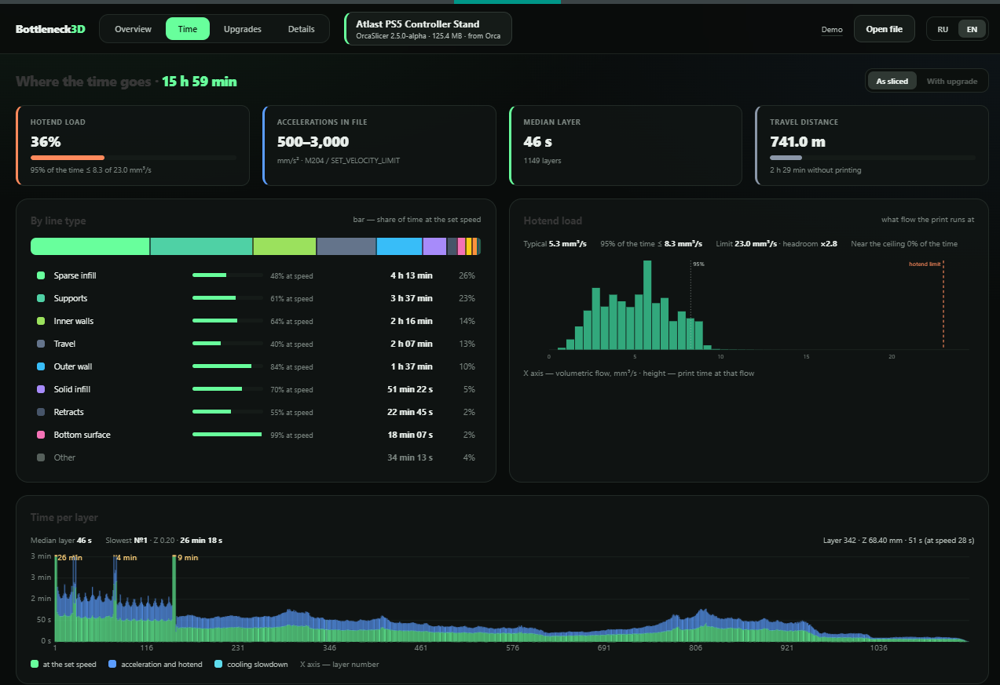
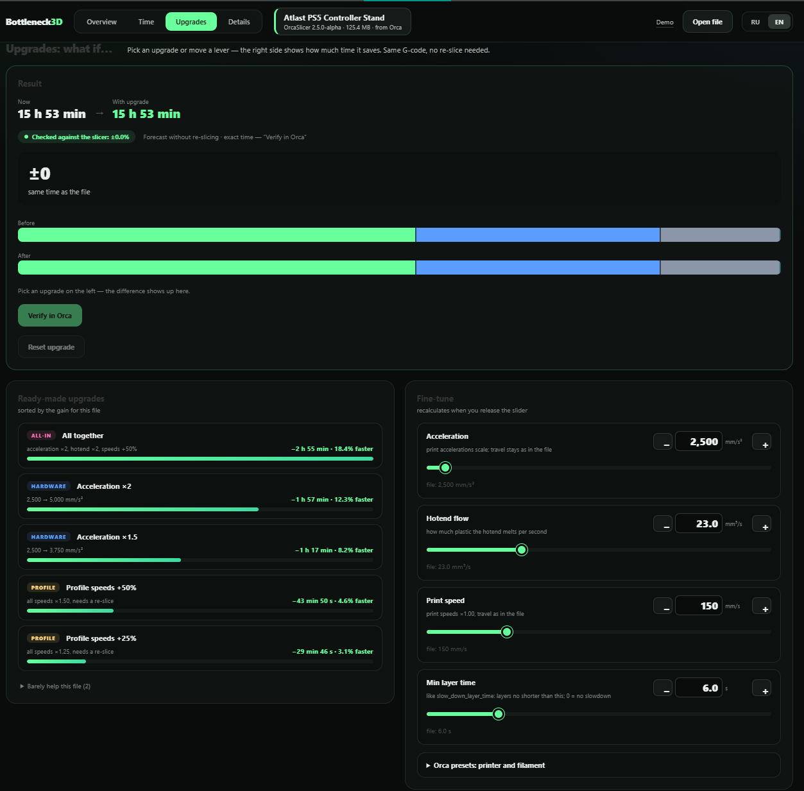
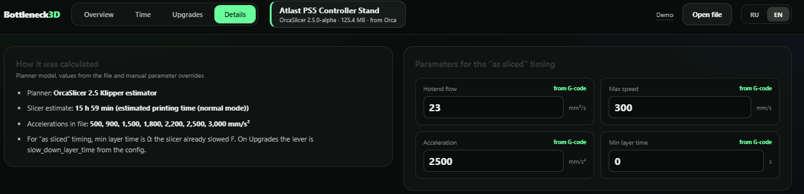

# Bottleneck3D

[](https://github.com/ContextForgeAI/bottleneck3d/releases)
[](https://github.com/ContextForgeAI/bottleneck3d/releases)

**Analyze any G-code in your browser. Get deeper insights and verify upgrade
scenarios inside OrcaSlicer 2.5+.**

Bottleneck3D shows **where a 3D print spends its time** and what an upgrade
would really change (acceleration, speed, hotend flow, minimum layer time).

It runs as a **standalone web page** and, optionally, as a tab inside OrcaSlicer.
The UI is available in English and Russian. Nothing is uploaded.

| Mode | OrcaSlicer version |
| --- | --- |
| **Web app** (open a `.gcode` in the browser) | **Not tied to 2.5.0-alpha.** Works with G-code from older Orca (e.g. 2.4), PrusaSlicer, and similar. No plugin install. |
| **Orca plugin** (tab inside the slicer) | Needs **2.5.0-alpha or newer** (Python plugins). |

---

## Install the Orca plugin (optional)

Only if you want the tab inside Orca. You need OrcaSlicer **2.5.0-alpha or newer**
and one file. **Node and Python are not required.** Older Orca cannot install this
plugin — use the web app instead and open your exported `.gcode`.

1. Download the plugin from the release  
   **[v0.4.0 → Assets → `bottleneck3d_orca-0.4.0-py3-none-any.whl`](https://github.com/ContextForgeAI/bottleneck3d/releases/tag/v0.4.0)**  
   (Assets is at the bottom of the page; do not download Source code).
2. In Orca: menu ≡ → **Plugins** → **Browse plugins** ▾ →  
   **Install local plugin** → pick the `.whl`.
3. **Restart Orca.**
4. Slice a model → **Export G-code** → open the **Bottleneck3D** tab.

Full guide (update, uninstall, troubleshooting):  
**[docs/INSTALL-ORCA.md](docs/INSTALL-ORCA.md)**

Tested on Windows.

---

## Screenshots

After install, Bottleneck3D appears as a tab next to Prepare / Preview / Device.
Export G-code, then open the tab.

**Overview** — print time, trust badge vs the slicer, where time goes, and the
best upgrades for this file:



**Time** — time by line type, hotend load, and time per layer:



**Upgrades** — ready-made scenarios and sliders; **Verify in Orca** reslices for
an exact estimate:



**Details** — which planner was used and the limits taken from the G-code:



---

## What it does

- **Overview** — total time, the main bottleneck and the file it came from.
- **Time** — time by line role, volumetric flow and per-layer chart.
- **Upgrades** — ready-made upgrade scenarios ranked by savings for this file,
  plus manual levers. Inside Orca, **Verify in Orca** reslices the model with the
  chosen change and shows Orca's exact estimate next to the instant forecast.
- **Details** — the motion model, limits and settings read from the file.

## Accuracy

`npm run compare -- <files|folder>` checks the estimate against the one the
slicer wrote into the file. On the current test set (PrusaSlicer 2.5,
OrcaSlicer 2.4 and 2.5.0-alpha with Klipper, including files with G2/G3 arc
fitting) the mean difference is 0.1% and the worst is 0.6%.

The instant upgrade forecast does not reslice the model, so speed and
acceleration changes can differ from a real reslice: the slicer also rebuilds
per-layer slowdowns. **Verify in Orca** removes that error; on the test models it
matched Orca's own reslice to the second. The accuracy bench and its results
are in [`demo/accuracy-sweep/`](demo/accuracy-sweep/) and
[`docs/ACCURACY-TEST-PLAN.md`](docs/ACCURACY-TEST-PLAN.md).

All of this is agreement with the slicer's estimator, not with a real printer:
real print times have not been validated yet. Cura, Bambu Studio, SuperSlicer
and newer Orca builds are untested.

## Run the web app

The website does **not** require OrcaSlicer 2.5.0-alpha. Open any exported
`.gcode` (Orca 2.4, PrusaSlicer, etc.). You lose only the in-Orca extras
(live presets and **Verify in Orca**).

```bash
npm install
npm start        # dev server, opens the browser
```

Open a `.gcode` file, a `bottleneck3d-report.json`, or the built-in demo.

## Build / install plugin from source (developers)

```bash
npm install
npm run package:orca   # → dist-orca/*.whl  (give this file to users)
npm run install:orca   # build + install into %APPDATA% on this PC
```

Needs Node 24 and [uv](https://docs.astral.sh/uv/). Details:
[`orca-plugin/README.md`](orca-plugin/README.md).

## Checks

```bash
npm test
npm run lint
npm run build
cd orca-plugin && uv run --with pytest pytest tests
```

## Limitations

- The time card shows how far the number can be trusted: «checked against the
  slicer ±X%» or «approximate» with the reason (untested slicer, no estimate or
  config in the file, difference above 1%).
- Cooling impact comes from the configured minimum layer time, not from a
  thermal simulation.
- **Check in Orca** slices the plate as STL: modifiers, painting and per-object
  settings are lost. A baseline reslice without changes is subtracted to cancel
  most of that error.
- Do not base purchase decisions on the forecast alone until it is validated
  against real prints. See [ROADMAP.md](ROADMAP.md) and
  [`docs/IMPROVEMENT-PLAN.md`](docs/IMPROVEMENT-PLAN.md).
